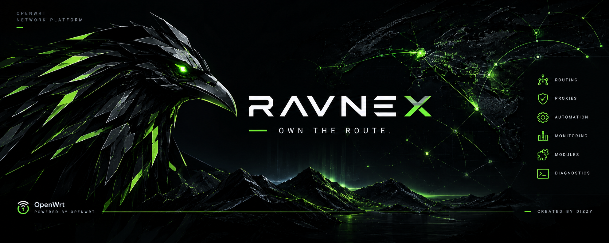

[**Русский 🇷🇺**](README.md) / [**English 🇬🇧**](README_en.md)



# Ravnex

**Own the Route.**

Многоядерная прокси-платформа для OpenWrt: VPN-подписки, обход DPI без VPN, автоматизация,
мониторинг и диагностика — всё из веб-интерфейса LuCI, всё локально на роутере.

> Ранее проект назывался **Re:HomeProxy AutoMod** (форк [ImmortalWrt HomeProxy](https://github.com/immortalwrt/homeproxy)).
> Начиная с ветки 3.0 проект развивается под именем **Ravnex**. Пакет и служба сохраняют техническое имя
> `homeproxy` — обновления с прошлых версий проходят на месте, без ручных шагов.

[](../../releases/latest)
[](../../stargazers)
[](LICENSE)
[](https://openwrt.org/)

## О проекте

**Ravnex** — это система управления сетевым трафиком на роутерах OpenWrt/ImmortalWrt, которая объединяет:

- **два прокси-ядра на выбор** — [hiddify-core](https://github.com/hiddify/hiddify-core) (форк sing-box, по умолчанию)
  и [sing-box-extended](https://github.com/shtorm-7/sing-box-extended) / компактный
  [sing-box-extended-lite](https://github.com/MANCrimSon/sing-box-extended-lite) для устройств с малым объёмом flash;
- **два движка обхода DPI без VPN** — [Zapret 2](https://github.com/bol-van/zapret2) (nfqws2) и
  [ByeDPI](https://github.com/hufrea/byedpi) (ciadpi) с каталогом стратегий, лабораторией подбора и автопилотом;
- **обучающий движок автоматизации**, который сам находит заблокированные ресурсы и маршрутизирует их;
- **горячий резерв узлов** (Hot Swap), **гонка DNS-серверов** (MultiDNS),
  **родительский контроль**, **Telegram-бот управления** и **самообновление приложения**.

Вся логика работает на **ucode** — нативном интерпретаторе OpenWrt, — поэтому приложение экономно расходует
RAM и не требует внешних сервисов: веб-интерфейс не обращается ни к каким CDN, все графики рисуются локально,
а проверка обновлений выполняется только по вашему запросу.

## Как идёт трафик

1. **Доверенные ресурсы** (Россия, банки, госуслуги) — напрямую, без задержек.
2. **Zapret 2 (`nfqws2`)** — рассинхронизация на уровне пакетов через NFQUEUE: YouTube, Discord и другие
   ресурсы открываются **без VPN и без подписки**, с быстрой работой и российским регионом.
3. **ByeDPI (`ciadpi`)** — SOCKS-десинхронизатор: 47 готовых пресетов и тестер стратегий.
4. **Прокси-ядро** — заблокированные и приватные маршруты через ваш узел/подписку: VLESS (Reality/XHTTP),
   Hysteria2, VMess, Trojan, Shadowsocks, WireGuard/**AmneziaWG**, SSH, NaiveProxy, Mieru и другие.
5. **Smart DNS** — раздельные пулы plain/secure DNS, гонка всех серверов пула на каждом запросе
   (движок [mosdns](https://github.com/IrineSistiana/mosdns)) с контролем качества и автоисключением мёртвых.

## Возможности

### Маршрутизация и надёжность
- **Мастер маршрутизации** — интерактивный центр: диагностика провайдера (что и как блокируется —
  напрямую/через ваши правила), «Сервисы → выходы» (каждому сервису — свой выход с живой проверкой),
  обход DPI, импорт каталогов стратегий.
- **Hot Swap** — горячий резерв для основного узла: несколько постоянно проверяемых соединений и
  переключение на живой резерв за секунды **без рестарта ядра**; анти-флап против лишних переключений.
- **URLTest с тремя режимами** — Авто / Приоритетный узел + авто / Ручной список; сторож мёртвых узлов.
- **Правила для России** — RU Proxy Rules (Russia Inside, Re:Filter) в один клик; исключение всего
  российского интернета из прокси.
- **Устойчивость прямых соединений** — отказ узла не рвёт SSH/DNS/соединения; OAuth-авторизации
  (Google/Microsoft/Apple) идут через закреплённый защищённый выход.

### Обход DPI
- **Strategy Lab** — фаззинг всего корпуса стратегий на изолированной NFQUEUE с baseline-прогоном,
  ранжированием по раундам и метриками «старт превью» и «скорость потока».
- **Автоподбор и автопилот** — подбор лучшей стратегии для YouTube/Discord одной кнопкой; автопилот
  по расписанию следит за качеством (вердикты жив/деградация/мёртв) и сам чинит сломавшуюся стратегию.
- **Композиция** — разные стратегии для разных ресурсов одновременно (профиль YouTube + профиль Discord
  + общий запасной), с серверным снапшотом и кнопкой отката.
- **Мультистратегии nfqws2** — один процесс с несколькими профилями и отдельными hostlist'ами;
  генератор собственных стратегий и редактируемый список ТСПУ (dpi-detect).

### Автоматизация и контроль
- **Движок самообучения** — находит заблокированные сайты (DNS/Clash/SNI-источники), различает тип
  блокировки (DPI / DNS-подмена / заглушка / страница отказа), самолечится и применяет выученное
  hot-reload'ом без разрыва соединений; нативные помощники (Go) для батч-проб и захвата SNI.
- **Контроль** — родительский контроль: устройства из живой сети, правила сайтов, расписания,
  Wi-Fi, журнал — и то же самое через Telegram-бота.
- **Telegram-бот v2** — статус, узлы, переключение без рестарта, снапшоты, пуш-уведомления
  (смена узла, сбои, обучение) с дедупликацией и rate-limit.

### Сеть и диагностика
- **MultiDNS (mosdns)** — каждый DNS-запрос гонится по всему пулу, побеждает самый быстрый живой ответ;
  демон качества проверяет, что возвращённые IP реально открывают сайты, и исключает мёртвые/отравленные.
- **Мониторинг узлов** — дашборд задержек и статусов, живой список соединений с поиском и фильтрами.
- **Обзор** — карточки всех подсистем, локальные SVG-графики (CPU/RAM/температура/соединения/задержка),
  трафик по выходам, быстрые действия.
- **Диагностика** — проверки ядра, DNS, перехвата nftables, связности + отчёт для поддержки.
- **Снапшоты и восстановление** — бэкап конфигурации в один клик, аварийное «вернуть интернет напрямую».

### Установка и обновление
- **Интерактивный установщик** — ставит приложение, ядро, подписку, Hot Swap, MultiDNS, автоматизацию
  и Zapret по шагам и **никогда не оставляет без интернета** (без подписки включается прямой режим
  и создаётся правило «YouTube → Zapret»).
- **Самообновление** — проверка и установка новой версии прямо из веб-интерфейса, без SSH.
- **Умный установщик ядер** — сам подбирает сборку под свободное место (включая компактную UPX) и
  архитектуру; асинхронная установка с прогрессом.

## Установка

Требования: OpenWrt/ImmortalWrt **24.10+** (opkg) или **25.12+** (apk). Рекомендуется ~40 МБ свободного места.

### Быстрая установка (одной командой)

```sh
wget -qO- https://raw.githubusercontent.com/ezdizzy/re-homeproxy/master/install.sh | sh
```

Интерактивный установщик проведёт по шагам: приложение + русский язык → ядро → подписка/узел →
Hot Swap → MultiDNS → Автоматизация → Zapret 2 с автотестом → автопилот → ByeDPI.
Повторный запуск скрипта открывает меню настройки. При заблокированном GitHub укажите зеркало
(переменная ставится перед `sh`):

```sh
wget -qO- https://raw.githubusercontent.com/ezdizzy/re-homeproxy/master/install.sh | GH_MIRROR=https://your.mirror sh
```

### Пакеты вручную

APK (OpenWrt 25.12+):

```sh
wget -O /tmp/homeproxy-hiddify.pub https://github.com/ezdizzy/re-homeproxy/releases/latest/download/homeproxy-hiddify.pub
cp /tmp/homeproxy-hiddify.pub /etc/apk/keys/
wget -O /tmp/app.apk "$(wget -qO- 'https://api.github.com/repos/ezdizzy/re-homeproxy/releases' | grep -o 'https://github\.com/[^"]*luci-app-re-homeproxy[^"]*\.apk' | head -1)"
apk add /tmp/app.apk
```

opkg (OpenWrt 24.10):

```sh
wget -O /tmp/app.ipk "$(wget -qO- 'https://api.github.com/repos/ezdizzy/re-homeproxy/releases' | grep -o 'https://github\.com/[^"]*luci-app-re-homeproxy[^"]*\.ipk' | head -1)"
opkg install /tmp/app.ipk
```

Ядро, ByeDPI, Zapret 2 и mosdns ставятся на вкладке **«Ядро и службы»** веб-интерфейса —
установщик сам определит архитектуру и подберёт сборку. Подробные ручные шаги — в
[вики](../../wiki/Getting-Started-ru).

### Обновление

Вкладка **«Ядро и службы» → Application → Проверить обновление**. Версии сравниваются с последним
релизом GitHub; обновление ставится на месте, rpcd перезапускается автоматически. Обновления с
предыдущих версий (Re:HomeProxy AutoMod 2.x) проходят без ручных шагов — приложение уже называется
Ravnex после установки новой версии.

## Дорожная карта 3.0

Ветка 3.0 (ребрендинг Ravnex) развивает проект в четырёх направлениях:

- **Дизайн v3** — единая дизайн-система с фирменным стилем логотипа, иконотека, бренд-блок Обзора.
- **Support Bundle** — сбор полной диагностики (конфиги/логи/состояния демонов) в один архив
  с автоматической редакцией секретов: «Собрать отчёт» → приложить к issue или отправить боту.
- **YouTube-пробы v4** — длинные окна потока, контроль битрейта, учёт QUIC и региона googlevideo
  + калибровка по вашей оценке «работает хорошо/плохо» (backtest порогов подбора).
- **Аудит перед релизом** — утечки, быстродействие, зависания: статические проверки + 24-часовой
  стресс-прогон всех демонов.

## Документация

Полные руководства — в **[вики](../../wiki/Home)**:

- [Первая настройка](../../wiki/Getting-Started-ru) — от свежей установки до рабочего соединения
- [Управление ядром](../../wiki/Core-Management-ru) — hiddify-core или sing-box-extended, сборки, память
- [Поддерживаемые протоколы](../../wiki/Supported-Protocols-ru) — все протоколы и нужные им теги сборки
- [Подписки и импорт узлов](../../wiki/Subscriptions-ru) — share-ссылки, .conf, Amnezia `vpn://`, base64
- [Маршрутизация и контроль доступа](../../wiki/Routing-and-Access-Control-ru)
- [Настройки DNS](../../wiki/DNS-Settings-ru) — пулы, резервный DNS и MultiDNS
- [ByeDPI](../../wiki/ByeDPI-ru) · [Zapret](../../wiki/Zapret-ru) — пресеты, тестеры, стратегии
- [Пользовательская маршрутизация](../../wiki/Custom-Routing-ru) · [Пользовательский JSON](../../wiki/Custom-JSON-Config-ru)
- [Автоматизация](../../wiki/Automation-Status-ru) · [Устранение неполадок](../../wiki/Troubleshooting-ru)

## Безопасность и приватность

- **Только LAN** — приложение не открывает портов в WAN; локальные служебные слушатели работают
  только на loopback.
- **Всё локально** — интерфейс не обращается к внешним CDN/шрифтам; графики строятся на клиенте.
- **Подписанные бинарники апстрима** — ядра и DPI-движки скачиваются из официальных релизов
  (подписанные apk-ключи); сборка приложения — GitHub CI этого репозитория.

## Благодарности

Проект опирается на работы открытого сообщества:

- [ImmortalWrt HomeProxy](https://github.com/immortalwrt/homeproxy) — исходное LuCI-приложение
- [hiddify-core](https://github.com/hiddify/hiddify-core) · [sing-box-extended](https://github.com/shtorm-7/sing-box-extended) · [sing-box](https://sing-box.sagernet.org) — прокси-ядра
- [zapret2 (bol-van)](https://github.com/bol-van/zapret2) и [ByeDPI (hufrea)](https://github.com/hufrea/byedpi) — обход DPI; пакеты OpenWrt — [1andrevich](https://github.com/1andrevich)
- [Re:Filter](https://github.com/1andrevich/re-filter), [itdoginfo/allow-domains](https://github.com/itdoginfo/allow-domains) — списки маршрутизации
- [StressOzz/Zapret-Manager](https://github.com/StressOzz/Zapret-Manager) — каталог стратегий
- [1andrevich/homeproxy-hiddify](https://github.com/1andrevich/homeproxy-hiddify) — прямая основа ветки Re:HomeProxy

Все товарные знаки принадлежат их владельцам и упоминаются номинативно.

## Лицензия

[GPL-2.0-only](LICENSE) — как и исходный LuCI-приложение. Ядра и DPI-движки распространяются под
своими лицензиями и скачиваются при установке из собственных релизов.
