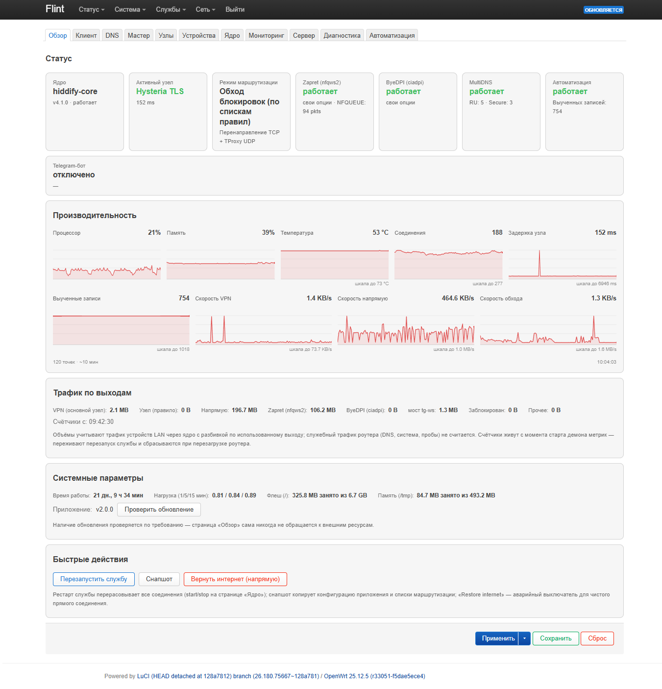
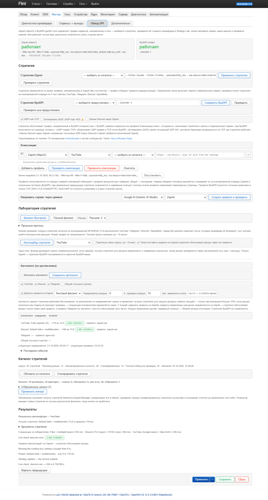
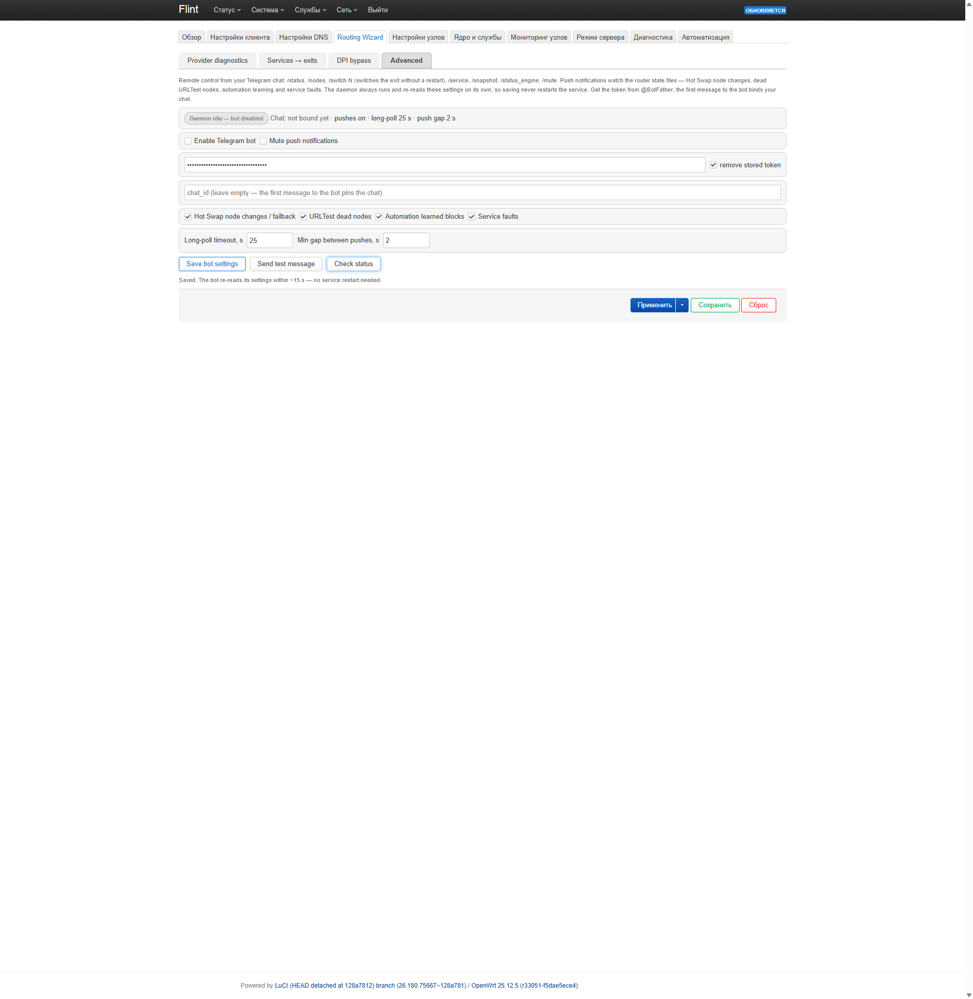
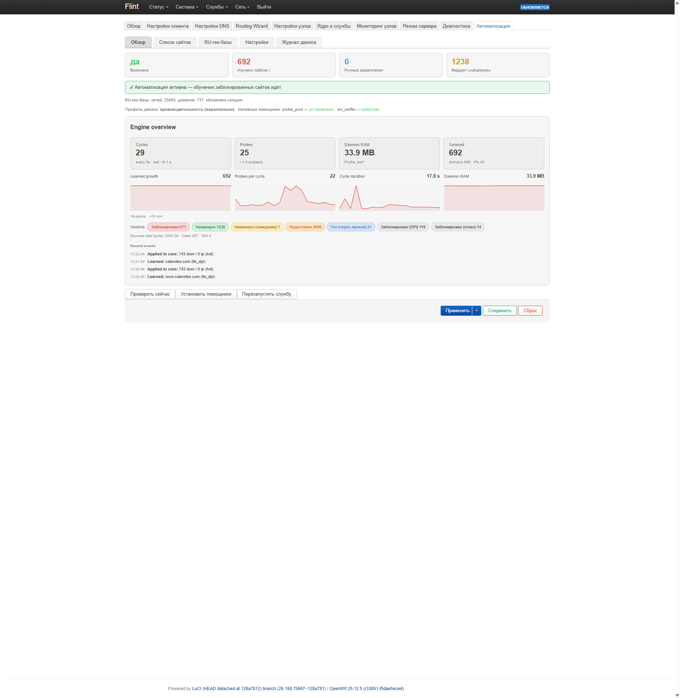

[**Русский 🇷🇺**](README.md) / [**English 🇬🇧**](README_en.md)

# Re:HomeProxy AutoMod
Оригинальный проект - https://github.com/1andrevich/homeproxy-hiddify


Современная многоядерная прокси-платформа на основе [hiddify-core](https://github.com/hiddify/hiddify-core),
[sing-box-extended](https://github.com/shtorm-7/sing-box-extended) и лёгкого
[sing-box-extended-lite](https://github.com/MANCrimSon/sing-box-extended-lite).
Форк [ImmortalWrt HomeProxy](https://github.com/immortalwrt/homeproxy).

> **Re:HomeProxy AutoMod** — мод Re-HomeProxy от **@ezdizzy**. Этот мод дополняет оригинальное приложение Re-HomeProxy
> доработками AutoMod (см. раздел *Доработки AutoMod* ниже) — прежде всего вкладкой **«Автоматизация»** и
> **самообновлением приложения из веб-интерфейса**. Ядра прокси, ByeDPI и Zapret берутся из собственных релизов вышестоящих
> проектов; здесь собираются только LuCI-приложение и его русская локализация (репозиторий `ezdizzy/re-homeproxy`).

## Обзор

Re-HomeProxy — многофункциональная система управления прокси, новый взгляд на HomeProxy от ImmortalWrt. Работает на выбор
ядра ([hiddify-core](https://github.com/hiddify/hiddify-core), [sing-box-extended](https://github.com/shtorm-7/sing-box-extended)
или лёгкий [sing-box-extended-lite](https://github.com/MANCrimSon/sing-box-extended-lite) для устройств с малым объёмом flash),
включает встроенный обход DPI на основе [Zapret2](https://github.com/bol-van/zapret2) и [ByeDPI](https://github.com/hufrea/byedpi)
для разблокировки сайтов без VPN, готовые правила маршрутизации для России и установщик ядра в один клик — всё из
веб-интерфейса LuCI.

## Что нового в 2.0

Версия 2.0 — масштабная переработка всего интерфейса (по-прежнему всё локально на роутере — без внешних ресурсов):

- **Новая главная страница «Обзор»** — карточки всех подсистем (ядро, активный узел, режим маршрутизации, Zapret/ByeDPI с
  именем живой стратегии и счётчиками NFQUEUE, пулы MultiDNS, Автоматизация, Telegram), inline-SVG графики
  (CPU / RAM / температура / соединения / задержка узла / рост изученных записей) с авто-шкалой, панель **«Трафик по
  выходам»** (кумулятивные объёмы и живые скорости для VPN / Напрямую / Zapret / ByeDPI / tg-ws — только трафик
  LAN-клиентов через ядро), системные параметры и быстрые действия (перезапуск службы, снапшот, аварийное «вернуть
  интернет (напрямую)»). Всё раздаётся локально — страница сама не ходит во внешние ресурсы; проверка обновлений
  только по требованию.
- **Мастер маршрутизации (центр приложения)** — интерактивный концентратор из четырёх вкладок:
  - *Диагностика провайдера* — проверяет YouTube, Discord, Telegram, Google AI, OpenAI, X, Instagram и др. через ваши
    **реальные пути**: напрямую, через основной узел и через **настроенную маршрутизацию** (правила, выученные списки,
    десинк Zapret/ByeDPI) — так, как обслуживаются LAN-клиенты. Обрыв цепочки редиректов — не успех; вердикты учитывают
    код возврата и гео («что-то пошло не так» у Gemini ловится). Показывает, каким правилом уже покрыт каждый ресурс.
  - *Сервисы → выходы* — выбор выхода для каждого сервиса (основной узел / конкретный узел / URLTest / Zapret / ByeDPI /
    Напрямую); Мастер держит одно правило на сервис (те же записи, что и ручной редактор), применяет и проверяет живьём
    в одном месте. Свои списки доменов — тоже здесь (продвинутые).
  - *Обход DPI* — статус движков, выбор стратегии с каталогом, **Strategy Lab** (быстрый/полный фаззинг всего корпуса
    стратегий на изолированной NFQUEUE с baseline и ранжированием по мажоритарности раундов), **Композиция** (профили
    по ресурсам для Zapret И ByeDPI: серверная сборка/тест, применение с серверным снапшотом и кнопкой Restore,
    переживающей перезагрузку страницы), **Автоподбор** в один клик (фаззинг → лучшая стратегия для ресурса →
    применение → живая проверка), **Автопилот по расписанию** (периодическая переразметка + живые проверки, которые
    немедленно подбирают сломавшуюся стратегию и держат правила управляемых ресурсов на Zapret), импорт каталога
    (StressOzz/Zapret-Manager), **генератор стратегий** и редактируемый **список ТСПУ** (dpi-detect). Пресеты
    стратегий ByeDPI, тестер и флаги движка тоже здесь — вкладки стратегий переехали из «Настроек узлов» в эту карточку.
  - *Дополнительно* — панель Telegram-бота (ниже) и карточки **«Telegram без прокси»** (TG WS Proxy, ниже).
- **Обзор движка автоматизации** — вкладка «Автоматизация» показывает, как реально работает обучающий движок: счётчики
  циклов/проб, RAM движка, спарклайн изученных записей, распределение вердиктов (DPI / DNS-подмена / заглушка / отказ /
  страница блокировки), источники последнего цикла и живая лента событий.
- **Telegram-бот v2** — HTML-сообщения с inline-клавиатурами: /status, /nodes, /switch N (переключает выход без
  рестарта), /service, /snapshot, /status_engine, /mute, плюс push-уведомления о сменах узла Hot Swap, мёртвых URLTest-
  узлах, обучении автоматизации и сбоях службы (дедуп + rate-limit, каждый тумблер настраивается в UI). Демон бота
  работает всегда и перечитывает настройки сам — сохранение никогда не рестартует службу.
- **Telegram без прокси (TG WS Proxy)** — сообщения Telegram работают **прозрачно для всей LAN, без VPN и без настроек
  прокси в приложениях**. Две дополняющие карточки в Мастере:
  - **Прозрачный мост** — Мастер ставит сторонний мост ([tg-ws-proxy-go](https://github.com/d0mhate/tg-ws-proxy-go), MIT)
    одной кнопкой: он работает локально (SOCKS5 на loopback, автоперезапуск procd) и несёт сообщения Telegram через
    WebSocket-путь, который DPI не блокирует; отдельное правило маршрутизации ведёт домены Telegram и IP дата-центров
    через него с автоматическим фолбэком на основной узел, если мост умрёт (звонки остаются UDP и едут через VPN, как
    раньше). Telegram покажет страну выхода релея вместо вашего домашнего IP — это ожидаемо.
  - **TG WS Proxy (rs)** — если вы уже используете [tg-ws-proxy-rs](https://github.com/valnesfjord/tg-ws-proxy-rs)
    сами, Мастер распознаёт его только для чтения, показывает статус и строит `tg://`-ссылку подключения для
    клиентов; в пакеты приложения чужой компонент не входит.
- **Страница «Устройства и интерфейсы»** — политика проксирования для устройств LAN, политика IP для WAN и привязка
  интерфейсов, отделены от настроек клиента; списки доменов переехали в Мастер, пустые вкладки скрываются по режиму.
- **Мультистратегии nfqws2** — один процесс nfqws2 умеет несколько профилей, у каждого свой `--hostlist` (например,
  отдельный профиль для YouTube плюс общий запасной); две такие составные стратегии уже в корпусе.
- **Снапшоты и восстановление, Hot Swap, MultiDNS** — сохранены и проверены (снапшот копирует конфигурацию приложения и
  списки маршрутизации; Hot Swap держит горячие резервы, проверенные реальными пробами, и переключается без рестарта
  ядра; MultiDNS гоняет каждый запрос по всему пулу и исключает мёртвые серверы).

## Скриншоты


*Обзор: карточки подсистем, локальные SVG-графики, системные параметры, быстрые действия.*


*Мастер — обход DPI: статус движков, каталог стратегий, фаззинг на изолированной очереди.*


*Мастер — Дополнительно: панель Telegram-бота v2 и карточка «Telegram без прокси».*


*Автоматизация: обзор обучающего движка со спарклайнами и лентой событий.*

## Безопасность и приватность

- **Только LAN** — приложение не открывает никаких портов в WAN. Опциональные компоненты «Telegram без прокси» тоже не
  открывают WAN: мост tg-ws-proxy-go слушает только loopback, tg-ws-proxy-rs — по его собственному README; ничто в
  приложении не выставляет роутер в интернет.
- **Только подписанные бинарники апстрима** — ядра и DPI-движки берутся из их официальных релизов (подписанные apk-ключи
  для hiddify-core/ByeDPI и zapret2). Само приложение собирается GitHub CI из этого репозитория.
- **Сторонние компоненты остаются сторонними** — tg-ws-proxy-go ставится кнопкой Мастера из официального релиза
  компонента (SHA256-проверка) и живёт своей procd-службой; tg-ws-proxy-rs (если вы его ставите) сохраняет собственную
  LuCI-страницу и собственную конфигурацию, Мастер только распознаёт его и строит `tg://`-ссылку. В пакеты приложения
  они не перепаковываются.
- Диапазоны портов приложения (диагностические инбаунды 5336/5337, листенеры MultiDNS, метрики) сверяются на пересечение
  с портами сторонних компонентов, прежде чем карточка интеграции отчитается о рабочем состоянии.

## Доработки AutoMod

Этот мод добавляет поверх оригинального приложения Re-HomeProxy:

- **Hot Swap (горячий резерв)** — держит несколько соединений одновременно (количество настраивается): основной узел
  плюс «горячие» резервы, которые постоянно проверяются реальными пробами. При потере основного узла трафик за секунды
  переключается на рабочий резерв **без рестарта ядра** — прямые соединения, SSH и DNS этого вообще не замечают.
  Настраивается на вкладке «Настройки клиента» (секция Hot Swap у конкретного основного узла), состояние — в
  «Мониторинге узлов».
- **Устойчивость прямых соединений** — сервис больше не перезагружается «на всякий случай»: отказ узла больше не вызывает
  рестарт (Hot Swap переключает селектор через API; в режиме URLTest сторож сначала заставляет ядро перепридумать узел
  принудительной пробой), перезагрузка при переподключении WAN отключена по умолчанию, а DNS в LAN получает резервный
  резолвер на время окна рестарта ядра.
- **Стабильность авторизации (OAuth)** — провайдеры авторизации (accounts.google.com, login.microsoftonline.com,
  appleid.apple.com, …) едут через тот же выход, что и использующий их сервис, резолвятся шифрованным DNS и ходят по TCP
  (QUIC/HTTPS-записи фильтруются). Лечит циклы «Войти через Google» на заблокированных сервисах (бесконечный
  socialSignInFailed), движок автоматики больше не выучивает auth-хосты по косвенным признакам.
- **Вкладка «Автоматизация»** — автоматическое обнаружение заблокированных сайтов. Фоновый монитор проверяет узлы и
  напрямую, и через прокси; домен, не открывающийся напрямую, но работающий через прокси, запоминается и пускается
  через прокси/ByeDPI/Zapret. Ловит и «сырые» IP-назначения (игры, дата-центры Telegram, приложения без SNI): повторяющиеся
  conntrack-адреса проверяются TCP-пробой через оба пути; общие CDN-сети исключены, выученные записи самолечатся
  (разблокированный сайт сам возвращается на прямой путь). Выученный список применяется hot-reload'ом — без рестарта
  и без разрыва соединений. Движок адаптивный: тайм-ауты и порог подтверждений подстраиваются под поведение хоста,
  кандидаты приоритизируются по суммарному весу источников (DNS / Clash / SNI), расписание циклов учитывает загрузку
  CPU и память роутера, plain-view DNS берётся с локального plain-листенера mosdns (когда активен MultiDNS). Опционально
  ставятся нативные помощники (Go, скачиваются с релизов под архитектуру): **probe_pool** — батч-проверка одним
  процессом с HTTP/2 вместо кучи shell-воркеров, **sni_sniffer** — непрерывный захват SNI с фильтром на уровне ядра
  вместо tcpdump; без них всё работает штатно классическими методами.
- **Сервисы → выходы в Мастере** — Google AI / Gemini, YouTube, Discord, Telegram и другие сервисы маршрутизируются
  явными правилами, которые вы настраиваете в Мастере: выберите выход для сервиса (конкретный узел, URLTest, Zapret/ByeDPI
  или напрямую), примените и проверьте живьём с проверкой региона выхода AI (Мастер предупредит, если страну/IP выхода
  откажет Google AI). Никаких скрытых захардкоженных списков — те же записи `proxy_ru_rule`, что и в ручном редакторе,
  поэтому оба представления всегда согласованы.
- **Страница «Настройки DNS»** — все DNS-настройки в одном меню: пулы серверов (обычный «Россия» 🔓 + шифрованный
  «Secure» 🔒), резервный DNS для схем без MultiDNS и движок **MultiDNS** с живым монитором качества.
- **MultiDNS (движок mosdns)** — ускоритель DNS: каждый запрос гоняется параллельно по всем серверам пула, возвращается
  самый быстрый живой ответ. Отдельный демон качества проверяет по HTTPS, что возвращённые серверами IP реально открывают
  сайты, и автоматически исключает (prune) мёртвые/отравленные серверы и IP. Настройка — страница **«Настройки DNS»**,
  установка/обновление mosdns — карточка в **«Ядро и службы»**.
- **URLTest с тремя режимами** — автовыбор узла: **Авто** (все импортированные узлы), **Приоритетный узел + авто**
  (выбранный узел используется первым, при его недоступности/замедлении — самый быстрый из остальных) и **Ручной список**
  (классический выбор узлов). Интервал проверки и допуск настраиваются (по умолчанию 30 с / 150 мс); при переключении
  старые соединения сразу закрываются. Починена эмиссия mieru для hiddify-core (формат диапазона портов) — раньше
  такой узел становился «Invalid» и блокировал переключение URLTest; монитор помечает узлы, которые ядро не смогло
  построить.
- **Вкладка «Мониторинг узлов»** — дашборд в духе Podkop/Forkop: карточки (ядро, активный узел с задержкой, Zapret,
  ByeDPI, счётчик живых узлов), таблица всех узлов с задержкой/статусом/пулом и **мониторинг соединений** — живой список
  активных соединений с хостами, цепочками, правилами и трафиком (с кнопкой «Закрыть все соединения»).
- **Исправление Tun TCP/UDP** — корректная доставка `tun_mark`-потоков в tun-устройство с защитой от зацикливания, так
  что маршрутизация в режиме Tun работает правильно.
- **Самообновление приложения** — на вкладке **«Ядро и службы»** можно проверить наличие новой версии и обновить
  LuCI-приложение (и русскую локализацию) на месте, без SSH-консоли. См. раздел *Обновление приложения*.
- **Форк по умолчанию** — `install.sh` ставит LuCI-приложение и русскую локаль из `ezdizzy/re-homeproxy` по умолчанию
  (ядра / ByeDPI / Zapret по-прежнему берутся из апстрима `1andrevich/*`).
- **Интерактивный установщик** — `install.sh` ведёт установку по шагам (подписка, Hot Swap, MultiDNS, Автоматизация, Zapret с
  автотестом стратегий) и **никогда не оставляет пользователя без интернета**: без подписки включается прямой режим и
  автоматически создаётся правило «YouTube → Zapret». Повторный запуск скрипта открывает режим настройки (меню).
- Полный перевод на русский (ru) всех вкладок, включая «Автоматизацию» и строки DNS-failover.

> ⚠️ Это экспериментальный мод. Устанавливая его, вы понимаете, что некоторые функции могут работать не так, как
> ожидается, — используйте на свой страх и риск.

## Ключевые возможности

- **Многоядерный движок** — работа на **hiddify-core** или **sing-box-extended** на ваш выбор. Встроенная страница
  **«Ядро и службы»** сама установит и обновит ядро и автоматически подберёт подходящую сборку под свободное место
  (включая компактную сборку для устройств с малым объёмом памяти). Оба ядра работают со всеми протоколами приложения;
  переключение «Предпочтительного ядра» учитывает возможности сборки — узлы, которые ядро не может загрузить,
  пропускаются автоматически (и отображаются в интерфейсе).
- **Широкая поддержка протоколов** — Naive (hiddify-core), Mieru, Hysteria, SOCKS, Shadowsocks, ShadowTLS, Trojan,
  VLESS (XHTTP), VMess, WireGuard, **AmneziaWG** (оба ядра), SSH и другие. Для WireGuard/AmneziaWG выбирается сетевой
  стек — userspace (gVisor) или модуль ядра (опция `wireguard_backend`: auto/system/gvisor в настройках узла):
  на сборках sing-box без gVisor kernel-стек включается автоматически, TUN-интерфейсы именуются уникально —
  несколько WG/AWG-endpoint'ов могут работать одновременно.
- **Два встроенных двига обхода DPI** — разблокировка сайтов и снятие троттлинга (например, YouTube, Discord) **без
  какой-либо VPN-подписки**:
  - **ByeDPI** ([hufrea/byedpi](https://github.com/hufrea/byedpi)) — рассинхронизирующий прокси на уровне SOCKS, 47
    готовых пресетов стратегий и **тестер стратегий** по нескольким сайтам, который показывает, какая настройка реально
    работает у вашего провайдера.
  - **Zapret 2** ([bol-van/zapret2](https://github.com/bol-van/zapret2), nfqws2) — рассинхронизация на уровне пакетов
    через NFQUEUE, искажает рукопожатие «на лету». Назначается в правилах маршрутизации (например, отправить через него
    только YouTube/Discord), с подобранными пресетами, опциональным обходом для голоса Discord и собственным тестером.
- **Автовыбор через URLTest** — три режима: **Авто** (все узлы), **Приоритетный узел + авто**, **Ручной список**.
  Автоматически направляет трафик через самый быстрый доступный узел и переключается при сбое.
- **Hot Swap** — горячий резерв для конкретного основного узла: несколько всегда проверенных соединений и прозрачное
  переключение на живой резерв за секунды, без рестарта ядра (см. *Доработки AutoMod*).
- **MultiDNS** — гонка всех DNS-серверов пула на каждом запросе (движок mosdns) + демон качества с HTTP-проверкой
  «сайт открывается» и автоисключением мёртвых серверов/IP.
- **Правила маршрутизации для России** — RU Proxy Rules в один клик (Russia Inside, Re:Filter) с готовыми списками
  доменов/IP, чтобы через прокси шли только заблокированные адреса.
- **Поддержка подписок** — импорт узлов по ссылкам подписок (sing-box JSON / Hiddify, base64 / обычные share-ссылки, а
  также JSON-конфиги Xray/V2Ray) и обновление по требованию.
- **Диагностика** — встроенная страница для проверки состояния ядра/системы, просмотра портов и формирования отчёта.
- **Мониторинг узлов** — наглядный дашборд: какие узлы живы, задержки, использование Zapret/ByeDPI и активные
  соединения (вкладка «Мониторинг узлов»).
- **Автоматизация** — автообнаружение заблокированных сайтов и маршрутизация их через прокси/ByeDPI/Zapret (см.
  *Доработки AutoMod*).
- **Самообновление приложения** — обновление LuCI-приложения прямо со вкладки «Ядро и службы».
- **Современный веб-интерфейс** — чистый адаптивный интерфейс LuCI с управлением узлами, маршрутизацией ACL и NFT-правилами.

## Требования

- OpenWRT / ImmortalWrt 24.10 или выше (opkg)
- OpenWRT / ImmortalWrt 25.12 или выше (apk)

Сборка для OpenWrt 23.05 снята с поддержки (ветка EOL): обновите OpenWrt до 24.10+.

## Установка

*Рекомендуется ~40 Мб свободного места. Мало места? Сначала установите пакет LuCI, затем на вкладке **«Ядро и службы»**
(Службы → Re:HomeProxy AutoMod → Ядро и службы) установите ядро — оно само подберёт подходящую сборку для устройств с
малым объёмом памяти.*

### Быстрая установка (одной строкой)

Интерактивный установщик: ставит LuCI-приложение (+ русский язык), затем **по шагам** проводит через всё остальное —
ядро прокси (с предупреждением, что без подписки Telegram/WhatsApp/Instagram и другие заблокированные сервисы работать
не будут), добавление подписки или строки подключения, включение **Hot Swap** (горячий резерв, по умолчанию включён),
**MultiDNS** и **Автоматизации**, установку
**Zapret 2** с автотестом стратегий (начинает с Hostfakesplit и проверяет YouTube), вопрос про **автопилот стратегий**
и **ByeDPI** (на ваше усмотрение).

Ключевое: **без подписки вы не останетесь без интернета** — скрипт включит прямой режим и сразу создаст правило
«Источник YouTube → Узел Zapret». Повторный запуск скрипта открывает **режим настройки** (меню): добавить подписку/узел,
выбрать основной узел, вкл/выкл MultiDNS и Автоматизацию, подобрать стратегию Zapret, включить Telegram-бота и
«Контроль», обновить ядро и т.д. Работает на APK (25.12+) и opkg (24.10). Выполните по SSH на роутере:

```sh
wget -qO- https://raw.githubusercontent.com/ezdizzy/re-homeproxy/master/install.sh | sh
```

Скрипт проверяет, установлено ли уже приложение: если да — сразу открывает меню настройки, ничего не переустанавливая.

При заблокированном/замедленном GitHub можно указать зеркало (важно: переменная ставится перед `sh`, а не перед `wget`):

```sh
wget -qO- https://raw.githubusercontent.com/ezdizzy/re-homeproxy/master/install.sh | GH_MIRROR=https://your.mirror sh
```

Хотите вручную? Шаги по версиям — ниже.

### OpenWRT 25.12+ (APK)

#### 1. Установка пакета Re-HomeProxy

```sh
wget -O /tmp/homeproxy-hiddify.pub https://github.com/ezdizzy/re-homeproxy/releases/latest/download/homeproxy-hiddify.pub
cp /tmp/homeproxy-hiddify.pub /etc/apk/keys/
wget -O /tmp/luci-app-re-homeproxy.apk "$(wget -qO- 'https://api.github.com/repos/ezdizzy/re-homeproxy/releases' | grep -o 'https://github\.com/[^"]*luci-app-re-homeproxy[^"]*\.apk' | head -1)"
apk add /tmp/luci-app-re-homeproxy.apk
```

После того как ключ окажется в `/etc/apk/keys/`, он будет доверенным постоянно — флаг указывать при последующих
обновлениях не нужно.

#### 2. Установка компонентов на вкладке **«Ядро и службы»**

Откройте **Службы → Re:HomeProxy AutoMod → Ядро и службы** и установите нужное — установщик сам подберёт сборку под
свободное место:

- **Ядро прокси** *(обязательно, выберите одно)* — [hiddify-core](https://github.com/hiddify/hiddify-core) (по умолчанию;
  включает NaïveProxy) или [sing-box-extended](https://github.com/shtorm-7/sing-box-extended) (более новая база sing-box 1.14
  с WARP / MASQUE / TrustTunnel в ядре; без NaïveProxy — такие узлы пропускаются автоматически).
- **ByeDPI** *(опционально)* — обход DPI на уровне SOCKS, снимает троттлинг без VPN, 47 пресетов и встроенный тестер
  стратегий.
- **Zapret 2** *(опционально)* — обход DPI на уровне пакетов (nfqws2), назначается в правилах маршрутизации, с подобранными
  пресетами и опциональным обходом для голоса Discord.
- **Re:HomeProxy AutoMod** *(само приложение)* — см. *Обновление приложения*; обновляется на месте из этой же вкладки.

#### 3. Установка языкового пакета RU

```sh
wget -O /tmp/luci-i18n-homeproxy-ru.apk "$(wget -qO- 'https://api.github.com/repos/ezdizzy/re-homeproxy/releases' | grep -o 'https://github\.com/[^"]*luci-i18n-homeproxy-ru[^"]*\.apk' | head -1)"
apk add /tmp/luci-i18n-homeproxy-ru.apk
```

---

### OpenWRT 24.10 (opkg)

#### 1. Установка пакета Re-HomeProxy

```sh
wget -O /tmp/luci-app-re-homeproxy.ipk "$(wget -qO- 'https://api.github.com/repos/ezdizzy/re-homeproxy/releases' | grep -o 'https://github\.com/[^"]*luci-app-re-homeproxy[^"]*\.ipk' | head -1)"
opkg install /tmp/luci-app-re-homeproxy.ipk
```

#### 2. Установка компонентов на вкладке **«Ядро и службы»**

Откройте **Службы → Re:HomeProxy AutoMod → Ядро и службы** и установите нужное — установщик сам подберёт сборку под
свободное место (те же опции, что в разделе APK выше).

#### 3. Установка языкового пакета RU

```sh
wget -O /tmp/luci-i18n-homeproxy-ru.ipk "$(wget -qO- 'https://api.github.com/repos/ezdizzy/re-homeproxy/releases' | grep -o 'https://github\.com/[^"]*luci-i18n-homeproxy-ru[^"]*\.ipk' | head -1)"
opkg install /tmp/luci-i18n-homeproxy-ru.ipk
```

### Ручная установка по SSH (вместо вкладки «Ядро и службы»)

Вкладка **«Ядро и службы»** предпочтительна — она сама определяет железо и подбирает подходящую сборку. Чтобы поставить
то же самое вручную по SSH, сначала определите архитектуру и формат пакетов:

```sh
. /etc/openwrt_release; ARCH="$DISTRIB_ARCH"
command -v apk >/dev/null && EXT=apk || EXT=ipk
echo "$ARCH / $EXT"
```

Пакеты hiddify-core и ByeDPI подписаны ключом `homeproxy-hiddify.pub`, который добавляется в доверенные при установке
приложения выше; если вы пропустили тот шаг — добавьте `--allow-untrusted` к `apk add`.

**Ядро прокси — выберите одно** (плюс необходимые модули ядра):

```sh
if [ "$EXT" = apk ]; then apk add kmod-nft-tproxy kmod-tun; else opkg install kmod-nft-tproxy kmod-tun; fi

# hiddify-core (по умолчанию; для компактной сборки замените 'latest/download' на 'download/upx')
wget -O /tmp/hiddify-core.$EXT "https://github.com/1andrevich/hiddify-core/releases/latest/download/hiddify-core_${ARCH}.${EXT}"
if [ "$EXT" = apk ]; then apk add /tmp/hiddify-core.apk; else opkg install --force-reinstall /tmp/hiddify-core.ipk; fi

# ...или sing-box-extended (AmneziaWG / WARP, самый широкий набор протоколов; без подписи)
URL=$(wget -qO- 'https://api.github.com/repos/shtorm-7/sing-box-extended/releases/latest' | grep -o "https://github\.com/[^\"]*${ARCH}[^\"]*\.${EXT}" | head -1)
wget -O /tmp/sing-box-extended.$EXT "$URL"
if [ "$EXT" = apk ]; then apk add --allow-untrusted /tmp/sing-box-extended.apk; else opkg install /tmp/sing-box-extended.ipk; fi
```

**ByeDPI** *(опционально)* — нужен `curl` (его использует встроенный тестер стратегий):

```sh
if [ "$EXT" = apk ]; then apk add curl; else opkg install curl; fi
URL=$(wget -qO- 'https://api.github.com/repos/1andrevich/ByeDPI-OpenWrt/releases/latest' | grep -o "https://github\.com/[^\"]*byedpi_[^\"]*${ARCH}\.${EXT}" | head -1)
wget -O /tmp/byedpi.$EXT "$URL"
if [ "$EXT" = apk ]; then apk add /tmp/byedpi.apk; else opkg install /tmp/byedpi.ipk; fi
```

**Zapret 2** *(опционально)* — нужен модуль ядра NFQUEUE:

```sh
if [ "$EXT" = apk ]; then apk add kmod-nft-queue; else opkg install kmod-nft-queue; fi
[ "$EXT" = apk ] && wget -O /etc/apk/keys/zapret2-1andrevich.pub "https://github.com/1andrevich/zapret2-openwrt/releases/latest/download/zapret2-1andrevich.pub"
wget -O /tmp/zapret2.$EXT "https://github.com/1andrevich/zapret2-openwrt/releases/latest/download/zapret2_${ARCH}.${EXT}"
if [ "$EXT" = apk ]; then apk add /tmp/zapret2.apk; else opkg install /tmp/zapret2.ipk; fi
```

### 4. Запуск службы

```sh
/etc/init.d/homeproxy start
```

Служба запускается автоматически при загрузке системы. Логи доступны в разделе **Службы → Re:HomeProxy AutoMod →
Ядро и службы**.

## Обновление приложения (самообновление AutoMod)

Для обновления Re:HomeProxy AutoMod **не нужна** SSH-консоль:

1. Откройте **Службы → Re:HomeProxy AutoMod → Ядро и службы**.
2. В карточке **«Application» (Приложение)** нажмите **Check update** (Проверить обновление). Приложение сравнит
   установленную версию (показывается как `Re:HomeProxy AutoMod vX.Y.Z`) с последним релизом `ezdizzy/re-homeproxy` на
   GitHub.
3. Если обновление доступно, нажмите **Update** (Обновить). Приложение скачает новый пакет `luci-app-re-homeproxy` (и
   русскую локализацию) и установит на месте; rpcd перезапустится автоматически и страница перезагрузится.

> Само приложение берёт свои сборки из `ezdizzy/re-homeproxy`. Ядра / ByeDPI / Zapret по-прежнему обновляются через свои
> карточки на той же вкладке (они приходят из апстрима). GitHub-токен (задаётся в **Ядро и службы → GitHub token**)
> повышает лимит обращений к GitHub API, который используется при проверке обновления.

## Версии и релизы

- **Схема версий:** семантическая `X.Y.Z` (например, `2.0.0`). Тег релиза на GitHub — `vX.Y.Z` и совпадает с
  `PKG_VERSION` приложения; самообновление сравнивает установленную версию с последним тегом релиза.
- **Текущий релиз: [2.0.0](../../releases/tag/v2.0.0)** — переработка интерфейса v2 (Обзор, Мастер маршрутизации,
  обзор движка Автоматизации, Telegram-бот v2, карточка TG WS Proxy, «Устройства и интерфейсы», мультистратегии nfqws2,
  сканер v2 с пробой настроенного пути). Требует OpenWrt / ImmortalWrt 25.12+ (apk).

## Документация

Полные руководства — в **[вики](../../wiki/Home)**:

- **[Первая настройка](../../wiki/Getting-Started-ru)** — от свежей установки до рабочего соединения, по шагам
- **[Управление ядром](../../wiki/Core-Management-ru)** — hiddify-core или sing-box-extended, умный установщик, память и компактная сборка
- **[Поддерживаемые протоколы](../../wiki/Supported-Protocols-ru)** — все протоколы, транспорты и нужные им build-теги
- **[Подписки и импорт узлов](../../wiki/Subscriptions-ru)** — share-ссылки, .conf, Amnezia `vpn://` (AmneziaWG/Xray), подписки, base64
- **[Маршрутизация и контроль доступа](../../wiki/Routing-and-Access-Control-ru)** — режимы маршрутизации, RU Proxy Rules, пер-девайс контроль доступа
- **[Настройки сервера](../../wiki/Server-Settings-ru)** — роутер как прокси-сервер (inbound-ы, типы, TLS/ACME)
- **[DNS и диагностика](../../wiki/DNS-and-Diagnostics-ru)** — чистый и защищённый DNS, утечки IPv6 и страница диагностики
- **[Настройки DNS](../../wiki/DNS-Settings-ru)** — новая страница: пулы серверов, резервный DNS и MultiDNS с монитором качества
- **[ByeDPI](../../wiki/ByeDPI-ru)** — обход DPI на уровне SOCKS, пресеты стратегий и тестер
- **[Zapret](../../wiki/Zapret-ru)** — обход DPI на уровне пакетов (nfqws2), пресеты, голос Discord и тестер
- **[Пользовательская маршрутизация](../../wiki/Custom-Routing-ru)** — узлы и правила маршрутизации в UI (матч по домену/IP/порту/протоколу/процессу)
- **[Пользовательский JSON конфиг](../../wiki/Custom-JSON-Config-ru)** — режим маршрутизации с «сырым» конфигом hiddify-core
- **[Автоматизация](../../wiki/Automation-Status-ru)** — вкладка AutoMod «Автоматизация» (состояния A–D, риски, TODO)
- **[Устранение неполадок](../../wiki/Troubleshooting-ru)** — типичные ошибки и их решение

## Благодарности и используемые проекты

Re-HomeProxy опирается на работу множества вышестоящих проектов. Приложение LuCI распространяется под GPL; ядра и движки
обхода DPI скачиваются при установке из их собственных релизов и остаются под своими лицензиями.

**Основа и ядра**
- [ImmortalWrt HomeProxy](https://github.com/immortalwrt/homeproxy) — исходное приложение LuCI, форком которого является проект
- [hiddify-core](https://github.com/hiddify/hiddify-core) — ядро прокси по умолчанию (форк sing-box от команды Hiddify)
- [sing-box-extended](https://github.com/shtorm-7/sing-box-extended) — альтернативное ядро с дополнительными build-тегами (AmneziaWG/WARP, самый широкий набор протоколов)
- [sing-box](https://sing-box.sagernet.org) — вышестоящий движок, на котором основаны оба ядра

**Движки обхода DPI**
- [hufrea/byedpi](https://github.com/hufrea/byedpi) — движок рассинхронизации ByeDPI (`ciadpi`); пакеты для OpenWrt — [1andrevich/ByeDPI-OpenWrt](https://github.com/1andrevich/ByeDPI-OpenWrt)
- [bol-van/zapret2](https://github.com/bol-van/zapret2) — движок рассинхронизации пакетов Zapret / nfqws2 / blockcheck2; пакеты для OpenWrt — [1andrevich/zapret2-openwrt](https://github.com/1andrevich/zapret2-openwrt); часть пресетов адаптирована из [flowseal/zapret-discord-youtube](https://github.com/flowseal/zapret-discord-youtube) (MIT)
- [StressOzz/Zapret-Manager](https://github.com/StressOzz/Zapret-Manager) — каталог стратегий, который импортирует раздел DPI Мастера (конвертируется в аргументы nfqws2 и заново проверяется на роутере)

**Опциональные сторонние компоненты (Telegram без прокси)**
- [d0mhate/tg-ws-proxy-go](https://github.com/d0mhate/tg-ws-proxy-go) (MIT) — прозрачный мост Telegram, который Мастер ставит одной кнопкой (SOCKS5 на loopback, служба под procd)
- [valnesfjord/tg-ws-proxy-rs](https://github.com/valnesfjord/tg-ws-proxy-rs) (MIT) — компонент «MTProto через WebSocket»; ставится только явным действием пользователя официальным установщиком самого компонента, Мастер распознаёт его только для чтения, в пакеты приложения он не входит

**Протоколы** — реализованы ядрами выше (см. [Поддерживаемые протоколы](../../wiki/Supported-Protocols-ru)):

Naive, Mieru, Hysteria/Hysteria2, TUIC, SOCKS, Shadowsocks/Shadowsocks 2022, ShadowTLS, AnyTLS, Trojan, VLESS (Reality, XHTTP), VMess, WireGuard, AmneziaWG/WARP, SSH.

**Списки маршрутизации**
- [Re:Filter](https://github.com/1andrevich/re-filter) — список доменов + IP по реестру РКН
- [itdoginfo/allow-domains](https://github.com/itdoginfo/allow-domains) — «Russia Inside» и сервисные списки (YouTube, Telegram, Discord, Meta и др.)
- [itdoginfo](https://github.com/itdoginfo) — HODCA и другие подобранные списки от itdoginfo

Все товарные знаки и названия сервисов принадлежат их владельцам и упоминаются номинативно — для обозначения трафика, к которому относится правило или список.
