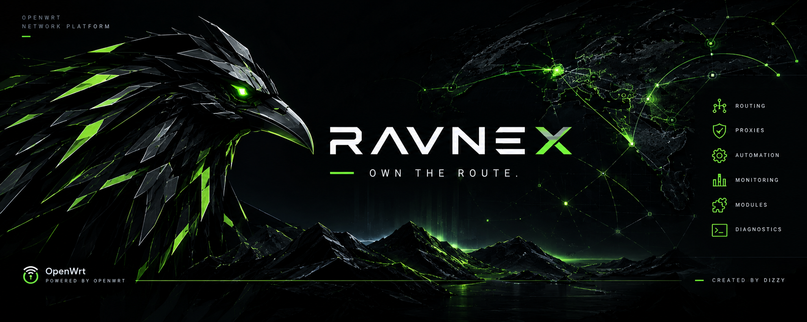

[**Русский 🇷🇺**](README.md) / [**English 🇬🇧**](README_en.md)



# Ravnex

**Own the Route.**

**A universal network-infrastructure management platform for OpenWrt.**

Routing, network-connection management, secure communication channels, transport mechanisms, automation, monitoring and diagnostics — in a single system with the LuCI web interface.

Ravnex brings together tools for managing network traffic and router infrastructure, providing centralized control over connections, routing policies, network services and system state. All core components run directly on the device, with no mandatory external services or cloud management infrastructure.

[](../../releases/latest)
[](../../stargazers)
[](LICENSE)
[](https://openwrt.org/)

---

## About the project

**Ravnex** is a software platform for centralized management of network infrastructure on OpenWrt and ImmortalWrt routers.

The project combines several independent technology directions in a single control environment:

- **Network connection management** — support for multiple proxy engines, subscription-based connections, custom configurations and a wide range of modern transport protocols.
- **Transport-layer adaptation** — tools for controlling connection-processing parameters, a strategy catalog, a testing lab and automated configuration picking.
- **Intelligent routing** — traffic distribution according to defined rules, automatic detection of connection characteristics and adaptation of network policies.
- **Fault tolerance** — connection redundancy, node health control, automatic failover and service recovery.
- **DNS management** — parallel server checks, response quality evaluation, separate resolution pools and automatic exclusion of faulty sources.
- **Automation** — diagnostic data collection, analysis of network resource availability, learning from measurement results and automatic application of proven configurations.
- **Access control** — management of connected devices, custom rules, schedules and centralized control via the web interface or Telegram.
- **Infrastructure monitoring** — the state of services, network connections, system resources, performance and events.

### Technology foundation

The control environment is **ucode**, the native OpenWrt interpreter. This allows the core logic to run directly on the router, avoiding the need to deploy additional universal runtime environments.

Depending on the task, specialized components are used:

| Direction | Technology |
|---|---|
| Proxy engine | hiddify-core |
| Alternative proxy engine | sing-box-extended / sing-box-extended-lite |
| Network packet processing | Zapret 2 (nfqws2) |
| Local connection processing | ByeDPI (ciadpi) |
| DNS management | mosdns |
| System integration | ucode, UCI, ubus, rpcd |
| Network rules | nftables |
| Specialized helpers | Go |

The web interface is fully self-contained: charts are generated locally, external CDNs and third-party libraries are not required, and the update-availability check runs only on user request.

## Network architecture

Ravnex uses a multi-layer model of network-traffic processing. Depending on the configured policy, connections are distributed among the corresponding processing mechanisms.

The primary classification is performed by **nftables**, which directs flows into the required contours without excessive packet hand-off between user-space processes.

| Contour | Technology | Purpose |
|---|---|---|
| Direct routing | nftables / system routing | Passing traffic through the standard network stack |
| Transport processing | Zapret 2 / nfqws2 | Controlling processing parameters and the transmission order of network packets |
| Local transport mechanism | ByeDPI / ciadpi | Alternative connection processing via a local SOCKS interface |
| Secure connections | hiddify-core / sing-box-extended | Building tunnels and routing through external nodes |
| DNS infrastructure | mosdns | Request processing, parallel DNS-source selection and response-quality control |

Each contour can be used independently of the others. This makes it possible to build different traffic-processing profiles, combine mechanisms and define individual rules for individual connection categories.

### Supported transport protocols

The proxy subsystem supports a wide range of protocols and connection mechanisms:

- VLESS (Reality / XHTTP);
- Hysteria2;
- VMess;
- Trojan;
- Shadowsocks;
- WireGuard / AmneziaWG;
- SSH;
- NaiveProxy;
- Mieru;
- other protocols supported by the selected core build.

Depending on the installed core and its configuration, the availability of individual transports may vary.

## Core architecture principles

### Local execution

The main control logic and background services run directly on the router.

- ucode is used for control processes and background automation.
- Go is used pointwise for specialized high-performance tasks.
- LuCI communicates with system services via rpcd and ubus.
- ACLs separate read operations from configuration changes.

The architecture does not require connecting to an external management platform.

### Configuration and state

Persistent configuration and operational state are kept separate:

- UCI and `/etc/config` — persistent settings;
- `/var/run` — ephemeral service state;
- tmpfs — intermediate data and operational working files.

This reduces the number of writes to flash memory and improves system resilience.

### Hot reload instead of constant restarts

Routing changes, resource lists and control rules are applied dynamically wherever possible.

Re-reading the configuration updates operating parameters without forcibly restarting all services and without unnecessarily dropping established connections.

### Last-known-good

Critical configurations use a mechanism that verifies and stores the last known-working state.

A new configuration:

1. Is generated separately from the active one.
2. Passes preliminary validation.
3. Is applied atomically.
4. Is verified against the running service.
5. Is stored as the last confirmed version.

If a malfunction is detected, the system returns to the previous working state.

### Fail-safe and fault tolerance

The architecture prescribes safe behavior when individual components fail:

- Until the TUN interface is ready, premature routing of traffic into a non-working route is blocked.
- If transport processors fail, traffic falls back to standard routing.
- If the firewall malfunctions, mechanisms for restoring network rules are provided.
- A backup of the provider's DNS parameters is kept.
- Emergency restoration of standard routing is available from the web interface.

The goal of these mechanisms is to keep the basic network infrastructure working even under a partial failure of the control components.

### Monitoring and self-recovery

The system uses several independent levels of control:

- **Health** — collects service state and produces diagnostic verdicts.
- **Sentinel** — monitors the monitoring machinery itself and configuration integrity.
- **Recovery** — coordinates restoration, manages retries and prevents endless repair loops.

Component states are classified as normal operation, degradation or failure, with a stated cause and confidence level.

### Component integrity control

System components are distributed through the own Ravnex repository, which hosts builds and mirrors of the official releases of the projects in use.

Packages are accompanied by manifests and SHA-256 checksums. Downloaded files are verified for integrity before installation.

---

## Features

### 1. Routing and connection management

- **Routing Master** — a single center for configuring network policies, connection diagnostics and transport-mechanism management.
- **Exit assignment** — an individual choice of traffic processing for various categories of applications and network resources.
- **Hot Swap** — a standby system for primary connections with several continuously verified connections and automatic failover to a healthy backup without restarting the core.
- **URLTest** — three node-selection modes: automatic, priority with backup and a manual list.
- **Node health control** — detection of failures, connection-quality degradation and unstable connections.
- **Custom policies** — creation of your own traffic-distribution rules.
- **Ready rule sets** — importing and applying routing catalogs, including RU Proxy Rules (Russia Inside, Re:Filter).
- **Pinned service connections** — the ability to assign separate routes for critically important system and authorization processes.

### 2. Transport mechanisms and connection adaptation

Ravnex combines several traffic-processing tools, allowing you to choose and combine suitable mechanisms depending on network characteristics and the equipment in use.

**Strategy Lab**

An isolated environment for testing transport configurations:

- validation of the strategy catalog;
- fuzzing and comparison of processing parameters;
- running tests through an isolated NFQUEUE;
- a control baseline run;
- staged ranking of results;
- measurement of connection-establishment time and data throughput.

**Automatic parameter picking**

- picking configurations for selected network-resource categories;
- comparing the results of several strategies;
- identifying working options;
- automatic application of the chosen configuration;
- quality control after application.

**Autopilot**

Periodically validates the active settings, detects degradation and, when necessary, proposes or applies an alternative configuration.

**Composite profiles**

Allow different processing parameters for different connection categories at the same time, with a shared fallback profile.

A server-side snapshot of the current configuration and a quick restore of the previous state are supported.

**Additional capabilities**

- several nfqws2 profiles within a single process;
- independent hostlists for different traffic categories;
- a custom strategy generator;
- editable diagnostic-signature lists;
- ByeDPI support with a catalog of 47 ready presets and its own strategy tester.

### 3. Intelligent automation

The built-in automation engine analyzes network-connection characteristics and helps adapt routing policies to changing network conditions.

Key capabilities:

- detecting resources with unstable or restricted connectivity;
- analyzing DNS-query results;
- testing connections with different transport mechanisms;
- collecting and correlating diagnostic signs;
- classifying the nature of network errors;
- detecting changes in connection behavior;
- forming new rules based on measurement results;
- automatically applying proven changes via hot reload.

Specialized Go helpers are used for performance, performing batch checks and collecting network-connection details, including SNI analysis.

The engine keeps the results of previous measurements, which allows it to account for connection-quality history and avoid unjustified configuration changes.

### 4. DNS infrastructure

**MultiDNS** is built on mosdns and designed to make domain-name resolution more resilient.

- Parallel execution of queries across available DNS sources.
- Selection of the fastest working response.
- Separate pools of plain and secure DNS servers.
- Availability and response-quality monitoring.
- Verification of actual reachability of the returned addresses.
- Automatic exclusion of faulty sources.
- Return of previously excluded servers after recovery.
- Reservation of system DNS parameters.

The system evaluates not only the DNS server's response time, but also the practical usability of the obtained results.

### 5. Access control and Telegram automation

Built-in tools let you manage the network environment without permanent access to the web interface.

**Parental control:**

- discovery of devices on the local network;
- individual per-device rules;
- control of access to network resources;
- schedules;
- Wi-Fi management;
- an event journal;
- remote control via Telegram.

**Telegram Bot v2:**

- retrieving the system state;
- viewing connections and nodes;
- switching the active connection without a core restart;
- creating and restoring snapshots;
- notifications about service state changes;
- automation event messages;
- repeat-notification control via deduplication and rate limiting.

### 6. Monitoring and diagnostics

Ravnex provides a centralized interface for observing the state of the router and its network components.

**Home dashboard:**

- subsystem states;
- CPU load;
- RAM usage;
- device temperature;
- connection count;
- latencies;
- per-exit traffic statistics;
- quick actions.

**Node monitoring:**

- latencies and availability;
- dynamic statuses;
- a list of active connections;
- search and filtering.

**Health center:**

- an overall system-state verdict;
- the state of each service;
- descriptions of detected problems;
- the degradation level;
- available recovery actions;
- a full event history.

**Diagnostic module:**

- proxy-core checks;
- DNS testing;
- nftables rules verification;
- network-connectivity analysis;
- transport-mechanism state control;
- generating a diagnostic report for technical support.

**Snapshots and recovery:**

- configuration backup;
- restoring a previous state;
- emergency return to standard routing;
- integrity control of configuration data.

### 7. Server mode

Besides managing outgoing connections, Ravnex allows the router to be used as an entry point for external connections.

Supported inbound protocols:

- VLESS;
- Trojan;
- Hysteria2;
- Shadowsocks;
- VMess;
- SOCKS / HTTP (mixed ingress);
- AnyTLS;
- MTProxy;
- other mechanisms available in the core build in use.

Server mode is independent of the client configuration. Both modes can be used simultaneously, individually, or fully disabled.

**Incoming-connection security management:**

- separate settings for each inbound;
- local-network access is restricted by default;
- individual control over port availability from the external network;
- TLS configuration;
- self-signed certificate generation;
- certificate issuance and renewal via ACME;
- Let's Encrypt and ZeroSSL support;
- HTTP-01 and DNS-01 (subject to the corresponding support in the build).

### 8. Installation and updates

**Interactive installer**

Automatically walks the user through the main stages of initial setup:

1. Installing the application and language components.
2. Choosing and installing the proxy core.
3. Importing a subscription or adding a connection.
4. Setting up Hot Swap.
5. Setting up MultiDNS.
6. Connecting automation.
7. Installing Zapret 2 and an initial configuration check.
8. Setting up the autopilot.
9. Installing and configuring ByeDPI.

The installer maintains safe intermediate states and keeps basic routing functional when optional components or connections are absent.

Re-running it opens the management menu of the installed system.

**Application self-update**

- checking the current version;
- retrieving release information;
- downloading and installing updates from the web interface;
- automatically restarting the required control services.

**Proxy-core management**

The installer automatically detects the device architecture, the available space and selects a suitable build.

All proxy cores and engines are installed directly from the ORIGINAL developer repositories (hiddify-core, shtorm-7, MANCrimSon, bol-van, hufrea) with SHA256 integrity verification. For resource-constrained devices, the compact UPX builds of sing-box-extended/lite are available where the originals publish them.

Installation runs asynchronously, displaying the current stage and progress.

---

## Performance and resource usage

Ravnex is developed with the constrained compute resources of routers in mind. The architecture aims to minimize background load, reduce redundant operations and behave predictably under a limited amount of physical memory.

### Performance profiles

The «Maintenance» section offers four profiles:

- **Auto** — automatic management of load parameters.
- **Eco** — minimized background activity and memory consumption.
- **Balanced** — a compromise between monitoring frequency and resource usage.
- **Performance** — increased check intensity and extended diagnostic samples.

The profiles change poll rates, history depth, sample sizes and the internal-state limits of the automation engine.

The economy mode additionally reduces the memory used by the self-learning engine, roughly by 10–15 MB.

### Memory management

- Background services have an `oom_score_adj` hierarchy.
- Under memory shortage, respawnable processes are terminated with a higher priority than base network services.
- DNS, Wi-Fi and the control plane are protected from unwarranted eviction.
- Each service has individual RSS and file-descriptor budgets.
- Sentinel controls resource overruns.
- On critical memory growth, a managed recovery of the proxy core is provided.

### Go memory limit

Go components use `GOMEMLIMIT`.

This keeps memory growth under control and bounds the heap size with respect to the device's physical RAM.

The proxy core has a default limit of 384 MB with an additional cap relative to physical memory.

### Minimal background activity

A minimized or inactive interface tab stops regular monitoring requests. Returning to the page automatically resumes data updates.

This avoids spending the router's compute resources on refreshing an interface that nobody is currently looking at.

### No mandatory swap

Ravnex does not require zram or swap to be configured.

The primary memory-management strategy is based on limiting consumption, controlling background processes and managed service recovery.

---

## Installation

**System requirements:**

- OpenWrt / ImmortalWrt 24.10+ (opkg).
- OpenWrt / ImmortalWrt 25.12+ (apk).
- About 40 MB of free space is recommended for installing the application. Additional components require their own space.

### Quick install

```sh
wget -qO- https://raw.githubusercontent.com/ezdizzy/ravnex/master/install.sh | sh
```

The interactive installer walks you through the main installation and configuration stages.

Re-running the script opens the installation-management menu.

When using a GitHub mirror:

```sh
wget -qO- https://raw.githubusercontent.com/ezdizzy/ravnex/master/install.sh | GH_MIRROR=https://your.mirror sh
```

### Manual package installation

**APK (OpenWrt 25.12+):**

```sh
wget -O /tmp/homeproxy-hiddify.pub https://github.com/ezdizzy/ravnex/releases/latest/download/homeproxy-hiddify.pub

cp /tmp/homeproxy-hiddify.pub /etc/apk/keys/

wget -O /tmp/app.apk "$(wget -qO- 'https://api.github.com/repos/ezdizzy/ravnex/releases' | grep -o 'https\://github\.com/[^"]*luci-app-ravnex[^"]*\.apk' | head -1)"

apk add /tmp/app.apk
```

**opkg (OpenWrt 24.10):**

```sh
wget -O /tmp/app.ipk "$(wget -qO- 'https://api.github.com/repos/ezdizzy/ravnex/releases' | grep -o 'https\://github\.com/[^"]*luci-app-ravnex[^"]*\.ipk' | head -1)"

opkg install /tmp/app.ipk
```

Proxy cores, transport components and mosdns are installed separately via the:

**Maintenance → Core management** section

The installer detects the device architecture and picks a suitable build.

Full documentation: [Getting Started](../../wiki/Getting-Started-en).

### Updating

The update check is available in the interface:

**Maintenance → Core management → Application → Check update**

The update is installed directly on the device. The required control services restart automatically.

Migration from previous Re:HomeProxy AutoMod 2.x versions is supported by the built-in migration mechanism.

**Important:** updating from version 3.0.x to 3.1.0 and newer must be done via `install.sh`, not via the app's update button.

Version 3.1.0 renames the system package to `luci-app-ravnex`. The installer correctly migrates from the old package name.

---

## Documentation

Full guides are available in the project [Wiki](../../wiki/Home).

- [Getting started](../../wiki/Getting-Started-en)
- [Installation and updates](../../wiki/Installation-and-Updates-en)
- [Interface overview](../../wiki/Overview-en)
- [Core management](../../wiki/Core-Management-en)
- [Supported protocols](../../wiki/Supported-Protocols-en)
- [Subscriptions and node import](../../wiki/Subscriptions-en)
- [Routing Master](../../wiki/Routing-Master-en)
- [Routing and access control](../../wiki/Routing-and-Access-Control-en)
- [Hot Swap and reliability](../../wiki/Hot-Swap-and-Reliability-en)
- [Monitoring and connections](../../wiki/Monitoring-and-Connections-en)
- [Resources and performance](../../wiki/Performance-and-Resources-en)
- [Access control](../../wiki/Access-Control-en)
- [Telegram control](../../wiki/Telegram-en)
- [Automation](../../wiki/Automation-Status-en)
- [DNS settings](../../wiki/DNS-Settings-en)
- [ByeDPI](../../wiki/ByeDPI-en)
- [Zapret](../../wiki/Zapret-en)
- [Advanced rules](../../wiki/Custom-Routing-en)
- [Server mode](../../wiki/Server-Settings-en)
- [Troubleshooting](../../wiki/Troubleshooting-en)

---

## Security and privacy

Ravnex follows the principle of local control: core operations are performed directly on the user's hardware.

**Control-environment isolation**

- The web interface is intended for use from the local network.
- The application does not open incoming WAN ports on its own.
- Local service interfaces bind to loopback unless their purpose requires otherwise.
- Communication between the interface and background services goes through rpcd/ubus with permission separation.

**Local data processing**

- External CDNs and third-party cloud interfaces are not used.
- Charts and visualizations are generated directly in the browser.
- Operational state is stored locally.
- No external management platform is required for normal operation.

**Component integrity**

- An own release repository is used.
- Downloadable components are accompanied by checksums.
- Integrity is verified before installation.
- The application is built automatically via GitHub Actions.

**User control**

The user independently determines the nodes to connect, configurations, routing policies, network rules and external-availability parameters.

Certain functions related to receiving updates, downloading components and using external transport nodes involve corresponding network requests. Their parameters and conditions are determined by the chosen configuration.

---

## Credits

Ravnex is built on technologies and developments from the open-source community.

The project uses and develops solutions by the following developers:

- [ImmortalWrt HomeProxy](https://github.com/immortalwrt/homeproxy) — the original basis of the LuCI application.
- [hiddify-core](https://github.com/hiddify/hiddify-core) — the proxy engine.
- [sing-box-extended](https://github.com/shtorm-7/sing-box-extended) — an alternative proxy-engine implementation.
- [sing-box-extended-lite](https://github.com/MANCrimSon/sing-box-extended-lite) — a compact build.
- [sing-box](https://sing-box.sagernet.org) — the base technology platform.
- [Zapret 2](https://github.com/bol-van/zapret2) — the network-packet processing mechanism.
- [ByeDPI](https://github.com/hufrea/byedpi) — an alternative transport mechanism.
- [mosdns](https://github.com/IrineSistiana/mosdns) — the DNS infrastructure.
- [Re:Filter](https://github.com/1andrevich/re-filter) and [itdoginfo/allow-domains](https://github.com/itdoginfo/allow-domains) — network rule sets.
- [StressOzz/Zapret-Manager](https://github.com/StressOzz/Zapret-Manager) — the transport-strategy catalog.

We thank the authors of the listed projects and the entire OpenWrt community for open technologies, documentation and the ability to build our own solutions on top of them.

All trademarks and names belong to their respective owners and are used solely to identify technologies and components.

---

## License

[GPL-2.0-only](LICENSE).

The application's license matches the license of the original LuCI project. The external components in use are distributed under the terms of their own licenses.

---

## Legal information and disclaimer

### 1. Purpose of the software

**Ravnex** is a software tool for managing network infrastructure on OpenWrt and ImmortalWrt routers.

The software provides means of routing, network-connection management, channel balancing and redundancy, transport-traffic processing, monitoring, diagnostics and automation of network processes.

The ability to use individual technologies and components is determined by their functionality, the respective licenses and the configuration chosen by the user.

### 2. Compliance with the law

The software is distributed as a universal technical instrument. The mere presence of certain network mechanisms does not define the lawfulness of any particular usage scenario.

The user independently determines the goals of operation, the system configuration and the applied network policies, and bears responsibility for complying with the laws of their jurisdiction, contractual obligations and the rules of the administered network.

### 3. No network services provided

The author and copyright holder do not provide, as part of Ravnex:

- proxy servers;
- VPN servers and communication nodes;
- paid or free subscriptions;
- access keys and credentials;
- guaranteed access to external network resources.

All external connections and the corresponding configuration parameters are provided or determined by the user.

### 4. User responsibility

Installing, configuring and operating the software is carried out by the user independently.

The user is responsible for:

- the chosen configurations and network policies;
- the connected external services and nodes;
- incoming and outgoing connection settings;
- the security of their own credentials and keys;
- the consequences of changing the network configuration;
- compliance with applicable legal and contractual requirements.

### 5. Limitation of warranties

The software is provided **AS IS** under the terms of the GPL-2.0-only license.

The author and copyright holder do not guarantee absolute continuity of operation, compatibility with all hardware models, the absence of errors, the permanent availability of external components, or the achievement of specific network-connection characteristics.

Nothing in this documentation should be considered a guarantee of availability of specific external resources or the quality of third-party network services.

---

**Ravnex — Own the Route.**

*One platform. Multiple transports. Full control.*
